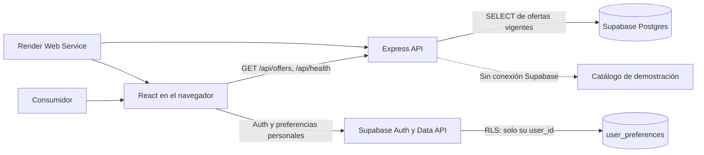

# ComparaOfertas

Catálogo web de demostración para comparar ofertas de cadenas. Permite buscar productos, filtrar por categoría y tienda, normalizar precios por kilogramo/litro/unidad, comparar presentaciones, guardar favoritos y umbrales en el navegador y armar una lista para ver el total por tienda.

## Stack

- **React 19 + Vite 6:** interfaz rápida y adaptable a móvil.
- **Node 22 + Express 5:** API REST pequeña, entrega la web y consulta el catálogo.
- **Supabase Postgres + `supabase-js`:** catálogo compartido de promociones. La API solo hace `SELECT` y la tabla aplica Row Level Security para exponer ofertas vigentes y con stock.
- **Render:** servicio web Node para publicar frontend y API bajo un mismo origen.
- **GitHub Actions:** un único workflow muestra calidad, pruebas, auditoría, SAST y escaneo de secretos; Render espera a que finalice correctamente antes de desplegar `main`.

El sitio inicia con un catálogo ficticio de 14 ofertas. La interfaz lo identifica como demostración y recomienda verificar cada oferta en la tienda. No se necesita ninguna credencial para probar el modo local.

## Arquitectura lógica



Render publica el frontend compilado y Express bajo el mismo dominio. React consulta las rutas `/api` en el mismo origen; el API devuelve solo ofertas vigentes y con stock desde Postgres, donde RLS filtra los registros públicos. El navegador usa la clave pública de Supabase para autenticación; las preferencias de una cuenta se escriben en `user_preferences` y sus políticas RLS limitan cada fila al propietario. La clave `service_role` no se envía al navegador. Si faltan las variables de Supabase, Express carga explícitamente el catálogo local de demostración.

| Herramienta | Motivo de elección para el caso |
| --- | --- |
| React + Vite | Permite actualizar búsqueda, filtros, comparación y lista sin recargar la página y generar un paquete estático ligero. |
| Node + Express | Aloja la interfaz y ofrece una API pequeña para centralizar el filtrado temporal y la consulta del catálogo. |
| Supabase Postgres + Auth | Modela productos y ofertas relacionadas en SQL y ofrece cuentas y preferencias por usuario con RLS. |
| Render | Ejecuta el servidor Node desde GitHub, valida el endpoint de salud y publica la aplicación en una URL HTTPS. |
| GitHub Actions | Automatiza calidad y seguridad sobre los commits y Pull Requests antes del despliegue de producción. |

## Ejecutar en local

```bash
npm ci
npm run dev
```

Abre `http://localhost:5173`. La API de desarrollo escucha en el puerto 10000. Para validar el paquete de producción: `npm run check`.

## Conectar Supabase

1. Ejecuta las migraciones de `supabase/migrations` en orden. Estas configuran el catálogo, preferencias por cuenta y políticas RLS.
2. Define `SUPABASE_URL` y `SUPABASE_ANON_KEY` en `.env` local o como variables privadas del servicio en Render. También se admite `SUPABASE_PUBLISHABLE_KEY`. Copia la URL y la clave pública del proyecto. La clave `service_role` no se usa ni se expone.
3. En Supabase abre **Authentication → URL Configuration** y agrega `https://comparaofertas-pc2.onrender.com` a **Redirect URLs** (y `http://localhost:5173` para desarrollo). Así los enlaces de confirmación y recuperación vuelven a la app.
4. Reinicia el servidor. `/api/health` debe indicar `dataMode: "supabase"` y `/api/config` debe responder con la URL del proyecto y una clave pública.

Las ofertas se pueden actualizar desde el SQL Editor con permisos de administrador. El rol `anon` solo tiene permiso de lectura condicionado por la política RLS; la app no expone endpoints para escribir en el catálogo. Los usuarios autenticados pueden guardar sus preferencias personales en `user_preferences`, donde RLS limita cada fila a su propietario.

## Flujo de ramas

- `main`: rama de producción; Render despliega desde aquí cuando pasan los checks.
- `test`: rama de integración y validación.
- Crea ramas de trabajo desde `test` con nombres descriptivos (`feature/...`, `fix/...`), usa commits claros en español y abre un Pull Request hacia `main` cuando CI esté verde y el cambio esté revisado.
- En GitHub configura protección para `main`: exigir Pull Request y los checks `CI/CD ComparaOfertas / quality` y `CI/CD ComparaOfertas / security`. La integración configurada para crear ramas desde el conector no tiene permiso de escritura; crea `test` desde una terminal con `git push -u origin test` si aún no existe.

## DevSecOps y CI/CD

| Fase | Práctica y herramienta | Seguridad aplicada |
| --- | --- | --- |
| Plan | Jira (épicas, historias, sprint, criterios de aceptación) | Añadir privacidad, validación de entradas y autorización a los criterios desde el backlog. |
| Code | Git (`test`, ramas de trabajo y Pull Request a `main`), ESLint | Revisar cambios antes de integrar; no guardar `.env` ni claves privadas en el repositorio. |
| Build | GitHub Actions con `npm ci`; Render ejecuta `npm run check` | Instalación reproducible desde `package-lock.json`; build no despliega si fallan validaciones. |
| Test | `node:test` en CI (`npm test`) | Pruebas unitarias del cálculo/filtros y pruebas de integración de la API, incluso cabeceras HTTP. |
| Release | Pull Request revisado y checks obligatorios antes del merge a `main` | El merge a producción queda bloqueado si no se satisfacen revisiones y controles configurados. |
| Deploy | Render despliega `main` con `autoDeployTrigger: checksPass` | Variables de Supabase se guardan en Render; nunca se usan claves `service_role` en el cliente. |
| Operate | Express, Supabase Auth y Postgres | Rate limiting, cabeceras de seguridad y políticas RLS limitan el acceso a preferencias de cada usuario. |
| Monitor | GitHub Actions, CodeQL, Gitleaks, Dependabot y logs/health de Render | Alertas por vulnerabilidades de código/dependencias/secretos y fallos de disponibilidad. |

### Pipeline automático en una ejecución

`.github/workflows/ci.yml` es el único workflow del proyecto. GitHub Actions presenta los jobs `quality` y `security` juntos en el mismo gráfico, ejecutándose en paralelo para cada push a `main`/`test`, Pull Request hacia `main` y ejecución manual. `quality` corre ESLint, pruebas unitarias y de integración y build; `security` instala dependencias fijadas y ejecuta `npm audit`, Gitleaks y CodeQL (SAST). Render despliega el servicio de producción desde `main` solo después de que los checks de CI terminen correctamente y aplica el health check `/api/health`. No hay un servicio de staging configurado; los Pull Requests sirven para validar los cambios antes de integrarlos.

### Fases y evidencias del ciclo

- **Plan/Code:** historias y transiciones del sprint en [Jira COF](https://gmcaceres.atlassian.net/jira/software/projects/COF/boards).
- **Build/Test/SAST/secretos:** jobs agrupados en una ejecución de [GitHub Actions](https://github.com/Gonzzzalo3/ComparaOfertasPC2/actions); CodeQL publica alertas en Security → Code scanning.
- **Deploy/Operate/Monitor:** la ejecución aprobada permite el despliegue de Render desde `main`; verifica la aplicación pública en [ComparaOfertas](https://comparaofertas-pc2.onrender.com/) y `/api/health`. Render ofrece eventos, logs y estado del servicio en [su panel](https://dashboard.render.com/web/srv-dbvsmpijnfac738anbd0).
- **Capturas:** toma las capturas directamente de la ejecución agrupada de Actions y del deployment de Render.

## Endpoints

- `GET /api/health`: estado, modo de datos y huso horario.
- `GET /api/config`: expone únicamente URL de Supabase y clave pública para inicializar Auth en el navegador.
- `GET /api/offers?q=&category=&chain=`: ofertas vigentes, ordenadas por precio normalizado.

En modo demo, precios, nombres de tiendas y enlaces son datos ficticios. Sin iniciar sesión, favoritos, umbrales y lista se conservan en `localStorage`; al iniciar sesión se sincronizan con la cuenta. Los reportes de precios de muestra permanecen en el navegador.

## Seguridad

- `.env`, `.env.*` y archivos de build están excluidos por `.gitignore`; publica solo `.env.example` sin valores reales.
- Activa secret scanning y Dependabot alerts en GitHub → Settings → Security. La regla de protección de `main` debe exigir PR y los checks del workflow antes de permitir merge.
- Ante una credencial expuesta: revócala/rotála en el proveedor y elimina el secreto del historial; borrar solo el archivo no revoca la clave.
